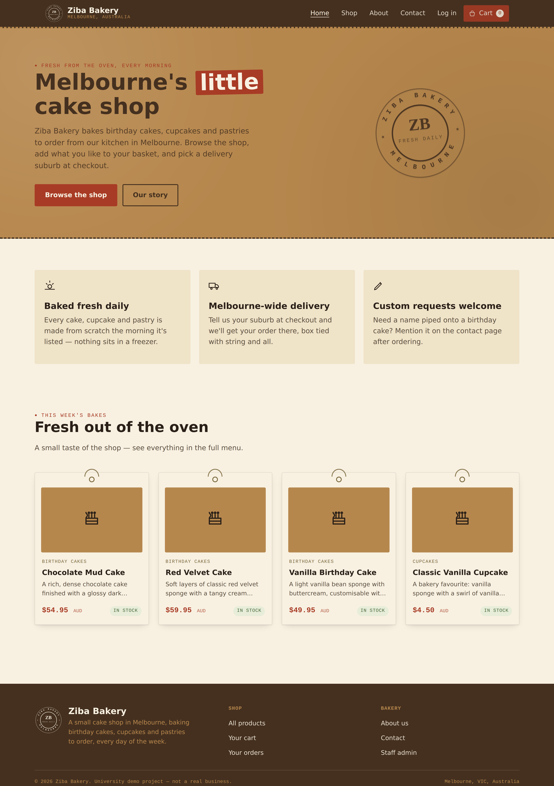
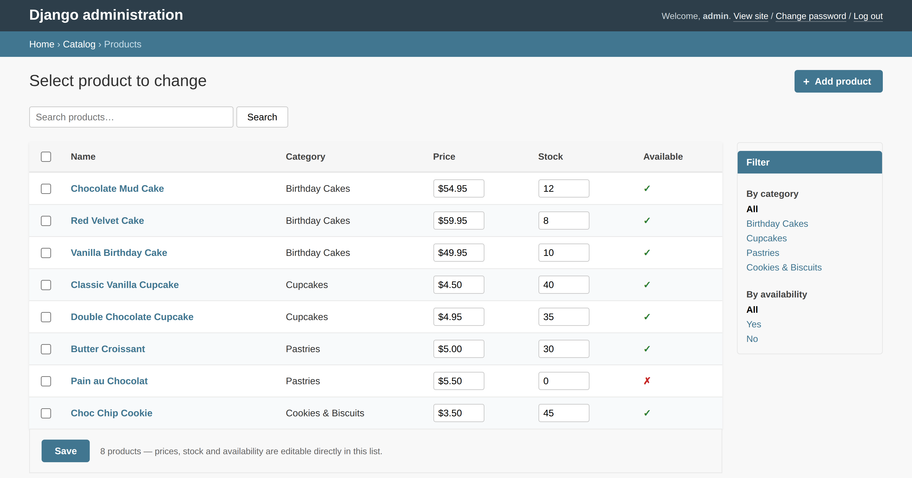
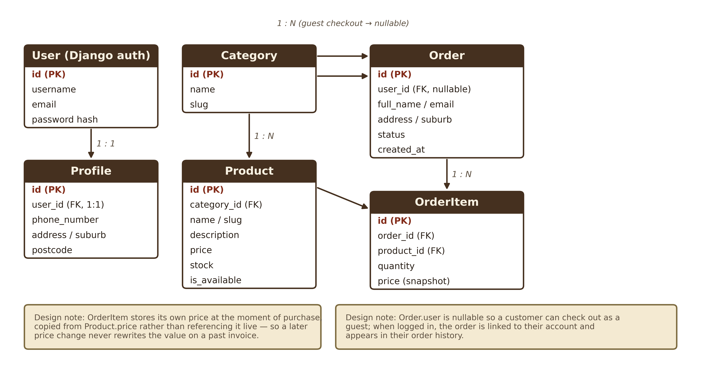

# 🥐 Ziba Bakery

[](https://www.python.org/)
[](https://www.djangoproject.com/)
[](https://www.sqlite.org/)
[](#-running-tests)
[](#license)

An online storefront and order management system for **Ziba Bakery**, an artisanal bakery and cake shop based in Melbourne, Australia. Built with Django as a university project.

<p align="center">
  
</p>

---

## ✨ Features

- **Product Catalog**: Browse cakes, cupcakes, pastries, and cookies by category with real-time stock levels.
- **Session Cart**: Add, update, and manage cart items without requiring an account.
- **Two-Step Checkout**: Delivery details form followed by simulated card payment validated with the **Luhn algorithm**.
- **Stock Integrity**: Atomic transactions (`transaction.atomic`) automatically verify and deduct inventory upon checkout.
- **User Accounts**: Registration, login, profile management with saved delivery details, and order history.
- **Custom Admin Dashboard**: Staff interface for tracking orders, managing products, and updating stock.

---

## 🛠️ Tech Stack

- **Backend**: Python 3.12+, Django 6.0
- **Database**: SQLite
- **Image Processing**: Pillow
- **Frontend**: Django Templates, Vanilla HTML5, CSS3 ("Kraft Bakery Box" theme), JavaScript

---

## 📁 Project Structure

```text
ziba_bakery/
├── ziba_bakery/        # Settings & URL configuration
├── core/               # Home, About, Contact pages
├── catalog/            # Products, categories & initial_data fixture
├── cart/               # Session-based cart & context processor
├── orders/             # Order processing, Luhn payment validation, stock deduction
├── accounts/           # User authentication, profiles & order history
├── templates/          # HTML templates per app
├── static/             # CSS styling & JS scripts
├── docs/figures/       # Screenshots & ER diagram
├── manage.py
└── requirements.txt
```

---

## 🚀 Quick Start

### 1. Clone & Set Up Environment
```bash
git clone https://github.com/MohammadMahdiAttai/Ziba-Bakery.git
cd Ziba-Bakery

# Windows (PowerShell)
python -m venv venv
.\venv\Scripts\Activate.ps1

# macOS / Linux
python3 -m venv venv
source venv/bin/activate
```

### 2. Install & Initialize
```bash
# Install dependencies
pip install -r requirements.txt

# Run migrations
python manage.py migrate

# Load sample bakery menu (4 categories, 12 products)
python manage.py loaddata initial_data

# Create staff admin user
python manage.py createsuperuser

# Start server
python manage.py runserver
```

Visit:
- **Shop**: [http://127.0.0.1:8000/](http://127.0.0.1:8000/)
- **Admin**: [http://127.0.0.1:8000/admin/](http://127.0.0.1:8000/admin/)

### 3. Running Tests
Run the comprehensive automated test suite (20 unit and integration tests):
```bash
python manage.py test
```

---

## 💳 Demo Checkout

Simulated payment credentials (no real money is charged):

| Field | Demo Value |
| :--- | :--- |
| **Card Number** | `4242 4242 4242 4242` (checked via Luhn algorithm) |
| **Expiry Date** | Any future date (e.g. `12/28`) |
| **CVC** | Any 3 digits (e.g. `123`) |

---

## 🔍 Admin & Architecture

<details>
<summary><b>🛠️ Click to view Django Admin Dashboard</b></summary>
<br>
<p align="center">
  
</p>
</details>

<details>
<summary><b>📐 Click to view Entity-Relationship (ER) Diagram</b></summary>
<br>
<p align="center">
  
</p>
</details>

---

## 🔒 Notes

- `DEBUG = True` and development `SECRET_KEY` are configured for local testing.
- For production, set `DEBUG = False`, provide `SECRET_KEY` via environment variables, and configure `ALLOWED_HOSTS`.

---

## 📄 License

Developed for academic and educational portfolio purposes.
